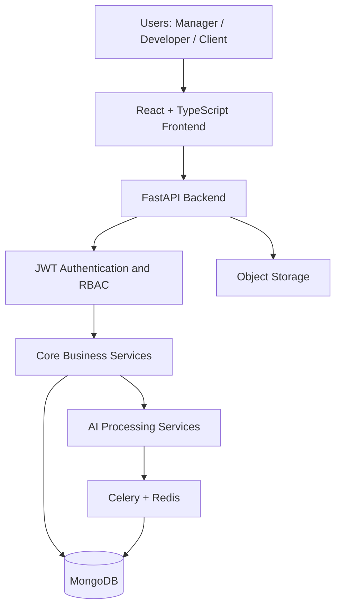

# ScopeSentry – System Architecture

## 1. Project Overview

ScopeSentry is an AI-powered project scope management and change intelligence platform designed to prevent uncontrolled project expansion in software development projects.

The platform manages original project requirements, analyzes incoming change requests, estimates their impact and maintains transparent approval workflows.

## 2. Architecture Design

ScopeSentry follows a modular three-tier architecture with independent AI processing and background services.

### Presentation Layer
- React.js
- TypeScript
- Tailwind CSS
- Recharts

Responsibilities:
- User interface
- Dashboard visualization
- Project management screens
- Requirement submission
- Approval management
- Analytics and reports

### API and Security Layer
- Python FastAPI
- JWT Authentication
- Role-Based Access Control (RBAC)
- Pydantic validation

Responsibilities:
- Handle frontend requests
- Authenticate users
- Validate incoming data
- Enforce permissions
- Connect frontend with business services

### Core Business Services
- Authentication Service
- Organization Service
- Project Service
- Requirement Service
- Change Request Service
- Approval Service
- Impact Analysis Service
- Audit Service
- Notification Service

### AI Processing Layer
- Document Requirement Extraction
- Semantic Requirement Comparison
- Scope Creep Classification
- Impact Analysis Assistance
- Project Risk Assessment
- AI Explanation Generation

AI results are reviewed by authorized project managers before becoming official project decisions.

### Background Processing Layer
- Celery
- Redis

Responsibilities:
- Document processing
- Asynchronous AI analysis
- Notification processing
- Long-running background jobs

### Database Layer
- MongoDB

Stores:
- Users
- Organizations
- Projects
- Requirements
- Documents
- Change Requests
- Approvals
- Audit Logs

### File Storage
S3-compatible object storage is planned for uploaded project agreements and documents.

## 3. System Architecture Flow

## 4. Main Application Modules

1. User Authentication and Management
2. Organization Management
3. Project Management
4. Document Upload and Processing
5. Requirement Management
6. Project Baseline Management
7. AI Scope Comparison
8. Change Request Management
9. Cost and Timeline Impact Analysis
10. Approval Workflow
11. Analytics and Reporting
12. Audit History and Notifications

## 5. Technology Stack

| Layer | Technology |
|---|---|
| Frontend | React.js, TypeScript |
| Styling | Tailwind CSS |
| Backend | Python FastAPI |
| Database | MongoDB |
| Authentication | JWT |
| AI Integration | LLM API |
| Background Jobs | Celery, Redis |
| Charts | Recharts |
| Document Processing | PyMuPDF, python-docx |
| File Storage | S3-compatible storage |
| API Testing | Postman |
| Deployment | Docker |

## 6. Security Architecture

- Secure password hashing using Argon2id or bcrypt.
- JWT-based authentication.
- Role-based access control.
- Input validation using Pydantic.
- Secure document upload validation.
- Organization-level data access restrictions.
- Append-only audit history.
- Environment-based secret management.

## 7. Expected Outcome

The architecture supports a scalable and modular full-stack application that provides intelligent requirement comparison, controlled change approvals, transparent project commitments and project risk monitoring.

**Project:** ScopeSentry  
**Internship:** SWYNEX Full Stack Developer Internship

