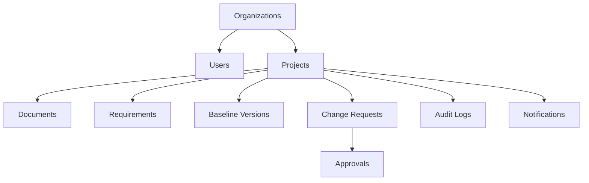

# ScopeSentry – Database Design

## 1. Database Overview

ScopeSentry uses MongoDB as its primary database.

The database follows a collection-based structure where related records are connected using MongoDB ObjectId references.

## 2. Main Collections

### 2.1 Users Collection

Stores registered user information.

Fields:
- _id: ObjectId
- name: String
- email: String (Unique)
- password_hash: String
- role: String
- organization_id: ObjectId
- is_active: Boolean
- created_at: Date

User roles:
- super_admin
- organization_admin
- project_manager
- developer
- client

### 2.2 Organizations Collection

Stores company information.

Fields:
- _id: ObjectId
- organization_name: String
- industry: String
- owner_id: ObjectId
- subscription_plan: String
- created_at: Date

### 2.3 Projects Collection

Stores project information and commitments.

Fields:
- _id: ObjectId
- organization_id: ObjectId
- project_name: String
- description: String
- client_id: ObjectId
- manager_id: ObjectId
- budget: Number
- currency: String
- start_date: Date
- deadline: Date
- status: String
- baseline_version: Number
- created_at: Date

### 2.4 Requirements Collection

Stores individual project requirements.

Fields:
- _id: ObjectId
- project_id: ObjectId
- requirement_title: String
- description: String
- category: String
- priority: String
- estimated_hours: Number
- status: String
- baseline_version: Number
- source_document_id: ObjectId

### 2.5 Documents Collection

Stores uploaded document metadata.

Fields:
- _id: ObjectId
- project_id: ObjectId
- uploaded_by: ObjectId
- file_name: String
- file_type: String
- storage_key: String
- file_hash: String
- processing_status: String
- uploaded_at: Date

### 2.6 Change Requests Collection

Stores new requirements submitted during development.

Fields:
- _id: ObjectId
- project_id: ObjectId
- submitted_by: ObjectId
- title: String
- description: String
- classification: String
- confidence: Number
- estimated_hours: Number
- additional_cost: Number
- deadline_impact_days: Number
- status: String
- ai_explanation: String
- created_at: Date

Classification values:
- in_scope
- modified_scope
- additional_scope
- duplicate
- unclear

### 2.7 Approvals Collection

Stores approval decisions.

Fields:
- _id: ObjectId
- change_request_id: ObjectId
- reviewer_id: ObjectId
- decision: String
- comments: String
- decided_at: Date

### 2.8 Audit Logs Collection

Stores historical application events.

Fields:
- _id: ObjectId
- project_id: ObjectId
- user_id: ObjectId
- action: String
- entity_type: String
- entity_id: ObjectId
- previous_state: Object
- new_state: Object
- timestamp: Date

## 3. Additional Collections

| Collection | Purpose |
|---|---|
| project_members | Project team members |
| baseline_versions | Historical scope versions |
| notifications | In-app notifications |
| analysis_jobs | AI processing status |
| comments | Change request discussions |

## 4. Collection Relationships

## 5. Database Indexing

Recommended indexes:

- Unique index on users.email
- Index on organizations.owner_id
- Index on projects.organization_id
- Index on requirements.project_id
- Index on change_requests.project_id
- Index on change_requests.status
- Index on approvals.change_request_id
- Index on audit_logs.project_id

## 6. Data Security

- Passwords must be stored as secure hashes.
- Use ObjectId references for related records.
- Restrict access based on organization and project permissions.
- Maintain historical baseline versions.
- Never silently overwrite approval history.
- Use transactions for important multi-document operations where supported.

## 7. Conclusion

The MongoDB design provides a modular and scalable data structure for managing projects, requirements, change requests, approvals and audit records.
